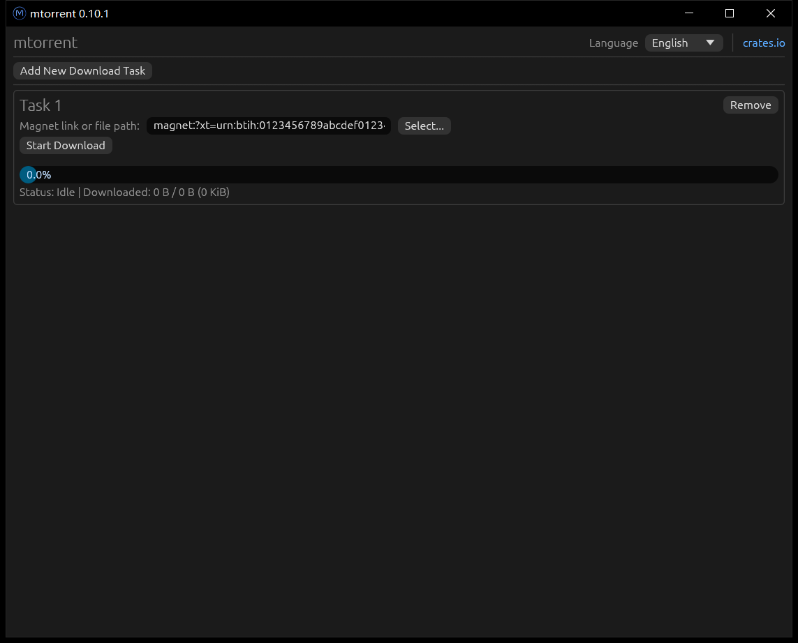

# mtorrent-egui

English | [简体中文](readme.zh-CN.md) | [Русский](readme.ru.md)

Simple graphical user interface for [mtorrent](https://github.com/DanglingPointer/mtorrent), built with egui.

Based on [mtorrent-gui](https://github.com/DanglingPointer/mtorrent-gui).

The interface is available in English, Simplified Chinese, Traditional Chinese and Russian. The selected language is saved between launches.

