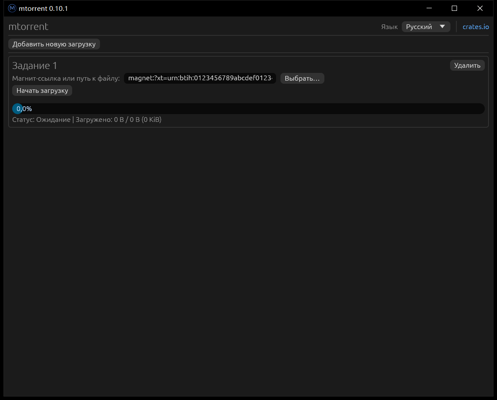

# mtorrent-egui

[English](readme.md) | [简体中文](readme.zh-CN.md) | Русский

Простой графический интерфейс для [mtorrent](https://github.com/DanglingPointer/mtorrent), построенный на egui.

Основан на [mtorrent-gui](https://github.com/DanglingPointer/mtorrent-gui).

Интерфейс доступен на английском, упрощённом китайском, традиционном китайском и русском языках. Выбранный язык сохраняется между запусками.

