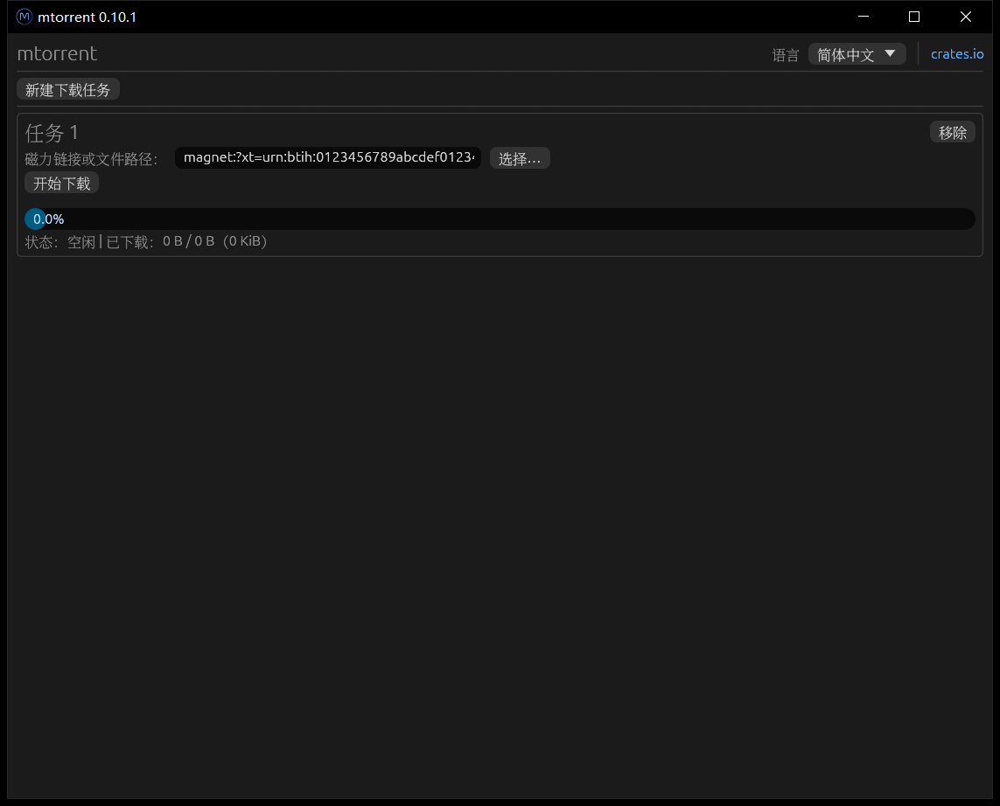

# mtorrent-egui

[English](readme.md) | 简体中文 | [Русский](readme.ru.md)

[mtorrent](https://github.com/DanglingPointer/mtorrent) 的图形界面，基于 egui 构建。

基于 [mtorrent-gui](https://github.com/DanglingPointer/mtorrent-gui)。

界面支持英文、简体中文、繁体中文和俄语，语言选择会在重启后保留。

